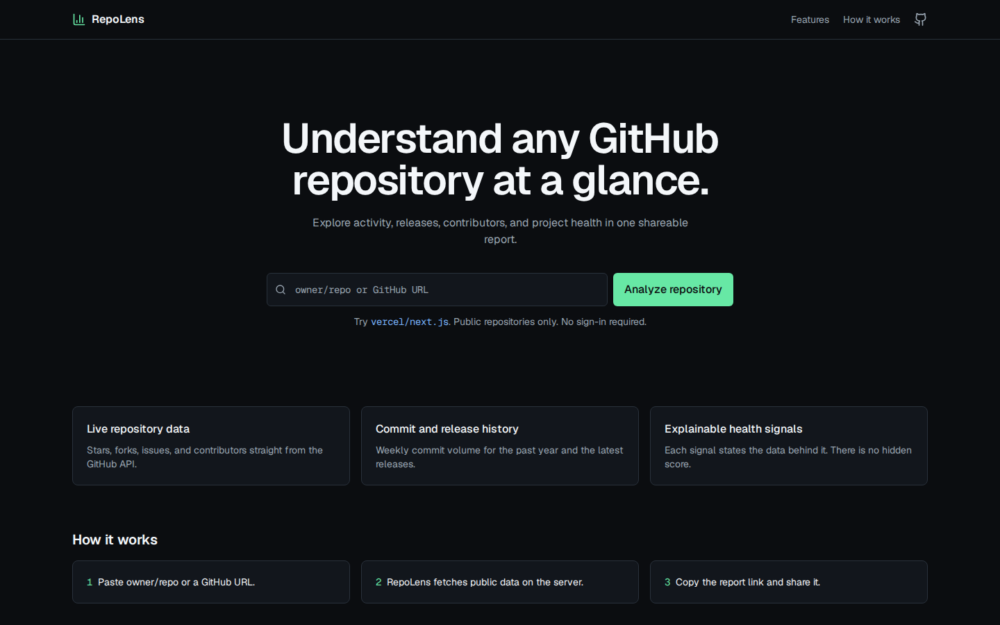
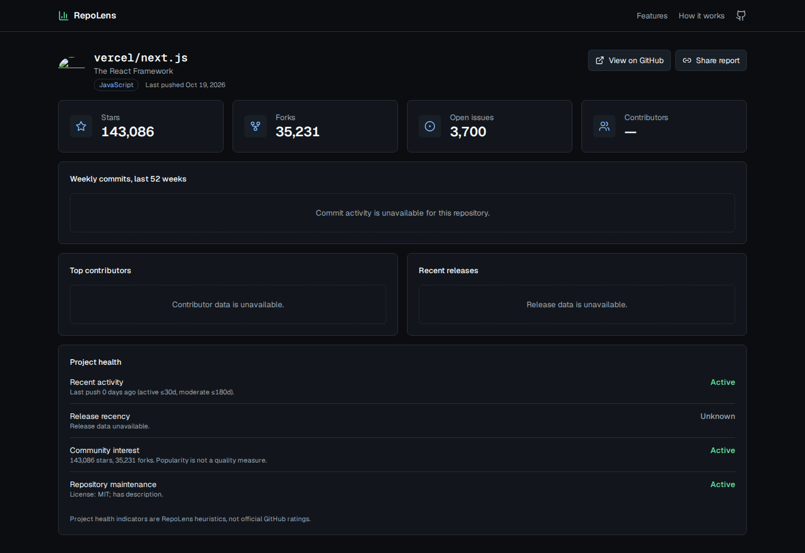

# Diplens

[](https://github.com/dipeshdarks/DipAi)

Understand any GitHub repository at a glance. Diplens turns public repository metadata into a readable, shareable analytics report: activity, releases, contributors, and explainable maintenance signals.

Built with Next.js App Router, React, TypeScript (strict), Tailwind CSS, Recharts, Lucide, and Zod. Data comes from the GitHub REST API, fetched and cached server-side.

**Author:** [dipeshdarks](https://github.com/dipeshdarks) · **Repository:** [dipeshdarks/DipAi](https://github.com/dipeshdarks/DipAi)

## Screenshots

### Home

Search any public repository by `owner/repo` or a full GitHub URL.



### Report

A single shareable page: metrics, weekly commit activity, contributors, releases, languages, and explainable health signals.



## Setup

```bash
npm install
cp .env.example .env.local   # optional
npm run dev                  # http://localhost:3000
```

## Environment variables

| Variable | Required | Purpose |
|---|---|---|
| `GITHUB_TOKEN` | No | Server-side only. Raises the GitHub rate limit from 60/h to 5,000/h. Use a free personal access token with public **read-only** scope. Never prefix with `NEXT_PUBLIC_`. |

The app works without a token for light usage (unauthenticated public access).

## Commands

```bash
npm run dev         # development server
npm run build       # production build
npm run start       # serve the production build
npm run lint        # ESLint
npm run typecheck   # tsc --noEmit
npm test            # vitest (unit + component tests)
npm run test:watch  # vitest watch mode
```

## Usage

1. Open the homepage.
2. Enter `owner/repo` or a `https://github.com/owner/repo` URL (press `/` to focus the search field).
3. Review the report: metrics, weekly commit chart, contributors, releases, languages, and health signals.
4. Click **Share report** to copy the canonical link (`/repo/{owner}/{repo}`).

## Architecture notes

- `lib/validation.ts` — Zod-validated input parsing (`owner/repo` or github.com URLs only).
- `lib/github.ts` — typed server-side GitHub client: 8s timeouts, per-endpoint cache TTLs, rate-limit/reset-aware error mapping, HTTP 202 (stats pending) handling, normalized camelCase types. Raw API payloads never reach UI components.
- `lib/health.ts` — explainable heuristic signals + chart summaries (pure, unit-tested).
- `types/report.ts` — stable normalized application types.
- `app/repo/[owner]/[repo]/` — server component report route with loading skeletons, message-aware error boundary, and not-found state.

Health indicators are Diplens heuristics calculated from visible data — not an official GitHub health score. Missing values render as `—`, never as fake zeros.

## Documentation website

In-app developer docs live at [`/docs`](https://diplensrepo.vercel.app/docs) in the same Next.js app.

- **Content:** MDX pages under `content/docs/` (11 pages: getting started, installation, quick start, core concepts, features, architecture, API reference, configuration, examples, troubleshooting, contributing).
- **Nav & metadata:** `lib/docs/registry.ts` + `lib/docs/pages.json`; previous/next and the sidebar are generated from one registry.
- **Search:** full-text, client-side (<kbd>⌘K</kbd> / <kbd>Ctrl+K</kbd>). The index is generated at `predev`/`prebuild` by `scripts/build-docs-index.mjs` into `lib/docs/search-index.json` — there is no runtime fs or search API, so it works on Vercel.
- **Components:** `components/docs/` (sidebar, TOC, search dialog, code blocks with copy, callouts, Mermaid diagrams, theme toggle).
- **Theme:** dark-first with a persisted light theme (`diplens-theme` in localStorage; no-flash inline script in `app/layout.tsx`).
- **SEO:** per-page canonical metadata, `app/sitemap.ts`, `app/robots.ts` (canonical base `https://diplensrepo.vercel.app`).

Regenerate the search index manually with `node scripts/build-docs-index.mjs` (also runs automatically before dev/build). Docs accuracy is treated as a bug — open an issue if a page disagrees with the code.

## Deploy (Vercel)

1. Push the project to GitHub.
2. Import it in Vercel (free tier is fine).
3. Optionally add `GITHUB_TOKEN` under Environment Variables (server-side only).
4. Deploy with the default Next.js build command.

## Testing

The suite covers URL normalization, input validation, GitHub error mapping, response normalization, missing-vs-zero handling, health-signal thresholds, empty chart datasets, partial API failures, search-form behavior, and share-link interaction.

```bash
npm test
```

## Known limitations

- GitHub commit statistics can return HTTP 202 while they are computed; the report shows a "still computing" state and a reload hint.
- Open-issue counts can include pull requests (GitHub endpoint semantics; labelled on the metric card).
- Contributor counts are GitHub's reported commit totals, not a complete measure of contribution.
- Unknown/invalid repositories render the human-readable not-found page; because the report route streams its loading shell, the HTTP status for that page is 200 rather than 404 (Next.js streaming behavior). The visible UX is a correct 404 state.
