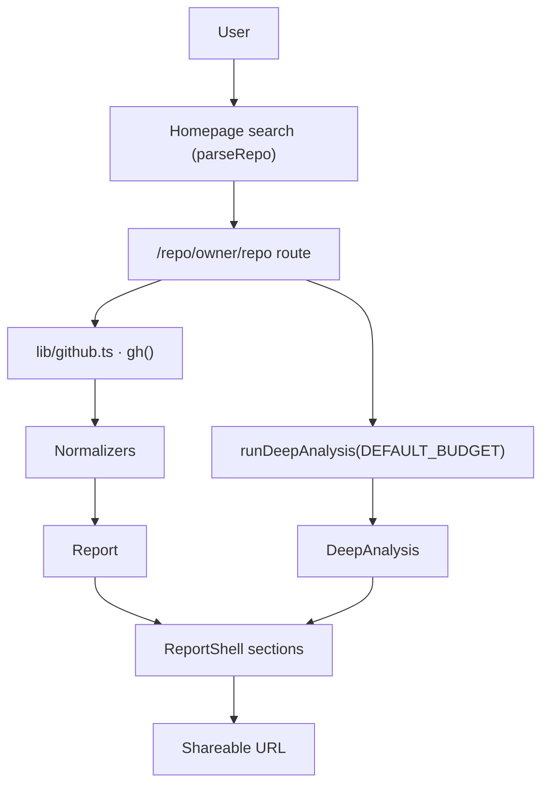
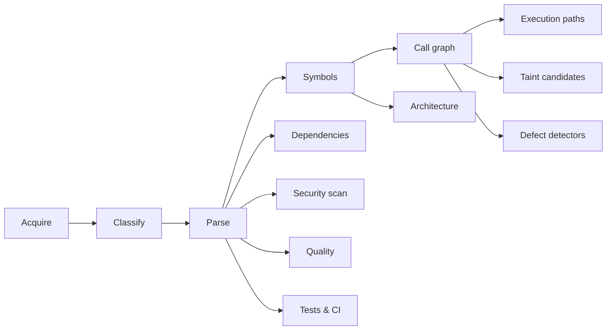

## Directory layout

The repository is a single Next.js App Router project:

```text
DipAi/
├── app/
│   ├── api/file/route.ts          # size-capped file-viewer API
│   ├── docs/                      # this documentation (/docs)
│   ├── repo/[owner]/[repo]/       # report route (+ loading/error/not-found)
│   ├── layout.tsx                 # root shell: header, footer, theme
│   ├── page.tsx                   # homepage with repository search
│   ├── sitemap.ts  robots.ts      # SEO metadata routes
│   └── globals.css                # design tokens (dark/light), prose, hljs theme
├── components/
│   ├── RepoSearch.tsx             # search form (client)
│   ├── ShareReportButton.tsx      # clipboard share (client)
│   ├── CommitActivityChart.tsx    # Recharts bar chart (client)
│   ├── ui.tsx                     # MetricCard, Panel, Chip, HealthSignal…
│   ├── report/                    # one component per report section
│   └── docs/                      # docs site components (sidebar, TOC, search…)
├── content/docs/                  # MDX sources for this documentation
├── lib/
│   ├── validation.ts              # Zod input parsing (owner/repo, file paths)
│   ├── github.ts                  # typed GitHub client + normalizers
│   ├── github/endpoints.ts        # tree/file/CI endpoints for the engine
│   ├── health.ts                  # explainable health heuristics
│   ├── analysis/                  # deep static-analysis pipeline
│   └── docs/                      # docs registry, search, MDX map
├── types/
│   ├── report.ts                  # normalized report types
│   └── analysis.ts                # analysis engine types
├── scripts/build-docs-index.mjs   # search-index generator (predev/prebuild)
└── package.json                   # scripts, deps, version
```

## Main modules

| Module | Responsibility |
|---|---|
| `lib/validation.ts` | Parse and validate `owner/repo` strings, GitHub URLs, and repository file paths. Pure; no I/O. |
| `lib/github.ts` | Authenticated (optional) fetch wrapper `gh()` with 8s timeouts, per-endpoint revalidation, typed `GitHubError`s, HTTP 202 pending handling, and the report assembly `getReport()`. |
| `lib/github/endpoints.ts` | Lower-level endpoints used by the analysis engine: head SHA, git tree, raw file content, commits, branches, tags, workflows, code-scanning probe. |
| `lib/health.ts` | `healthSignals()` and `summarizeWeeks()` — pure, unit-tested heuristics. |
| `lib/analysis/run.ts` | Orchestrates the full deep-analysis pipeline (`runDeepAnalysis`). |
| `lib/analysis/acquire/` | SHA-pinned raw-file acquisition with concurrency limits and byte budgets. |
| `lib/analysis/lang/` | tree-sitter WASM loaders and per-language extractors (TypeScript, Python, Go) + complexity. |
| `lib/analysis/index/` | Symbol tables, import/reference resolution. |
| `lib/analysis/graph/` | Call graph and execution-path walks over resolved edges. |
| `lib/analysis/flow/` | Taint catalogs (sources/sinks/sanitizers) and interprocedural taint search. |
| `lib/analysis/defects/` | Pattern-based defect detectors with verification plans. |
| `lib/analysis/architecture.ts` | Module graph + subsystem summary. |
| `lib/analysis/dependencies.ts` | Manifest parsers (npm, pip, Go modules, Cargo). |
| `lib/analysis/security.ts` + `redact.ts` | Secret-pattern scan; redaction of matched values before display. |
| `types/*` | Stable application types shared by the engine and UI. |

## Request flow



Everything inside the dashed server boundary runs in Next.js server components and route handlers on the server. The browser receives only rendered HTML and normalized data needed by client islands (chart, share button, file explorer).

## Analysis pipeline flow



Each stage records a `StageRecord` with status `complete` / `partial` / `unavailable` / `failed` / `skipped`, so the UI can show exactly what ran and what did not.

## Data flow

1. **Input** — raw user string → `parseRepo` → `RepoRef { owner, repo }` or `null`.
2. **Fetch** — `getReport(owner, repo)` fans out five GitHub REST calls through `gh()`; failures become `sectionErrors`, not exceptions (except the primary repository fetch).
3. **Normalize** — raw payloads → `Report` (camelCase, nullable-not-zero).
4. **Analyse** — `runDeepAnalysis(report, { budget })` acquires source text pinned to the head SHA, runs the pipeline, and returns `DeepAnalysis` + coverage. Engine exceptions are caught at the route boundary and surfaced as `analysisError`.
5. **Render** — server components compose `ReportShell` sections; client islands receive only the props they need.
6. **Share** — the URL `/repo/{owner}/{repo}` is the canonical artifact.

## External integrations

| Integration | Purpose | Notes |
|---|---|---|
| `api.github.com` REST | repository, contributors, stats, releases, languages, trees, workflows | API version `2022-11-28`; optional `Bearer` token |
| `raw.githubusercontent.com` | source text for analysis | SHA-pinned; does not consume the REST rate quota |
| Recharts | commit-activity chart | client component |
| tree-sitter WASM | parsing | `web-tree-sitter` + `tree-sitter-wasms`; externalized in `next.config.js` |

## Configuration & error handling

- Configuration is a single optional env var: `GITHUB_TOKEN` (see [Configuration](/docs/configuration)).
- `GitHubError` carries a `kind` (`not_found`, `rate_limited`, `unauthorized`, `forbidden`, `invalid`, `upstream`, `timeout`, `network`) that routes map to HTTP statuses and user-facing messages.
- The report route turns `not_found` into the not-found page; other kinds rethrow into the message-aware error boundary (`app/repo/[owner]/[repo]/error.tsx`).
- The analysis run is wrapped in its own try/catch: a failing engine never blanks the metadata report.
- The `/api/file` route validates all four query parameters, re-validates the repo identifier and file path, and maps upstream failures to 404/413/415/429/502/504/500 JSON errors.

## How modules communicate

- **Server components** call lib functions directly (`getReport`, `runDeepAnalysis`, `loadSections`); there is no internal HTTP hop.
- **Client components** receive primitive props (numbers, strings, arrays) — never class instances or fetch functions.
- **Types** flow one way: `types/*.ts` ← `lib/*` ← `app/*` / `components/*`. UI components never import raw GitHub payload shapes.
- **The docs subsystem** (`lib/docs/*`) is independent of the analysis engine: the registry drives navigation/SEO, the build script generates the search index, and MDX pages are statically imported via `lib/docs/mdx.ts`.

## Next step

For the exact exported surface of these modules, see the [API Reference](/docs/api-reference).
